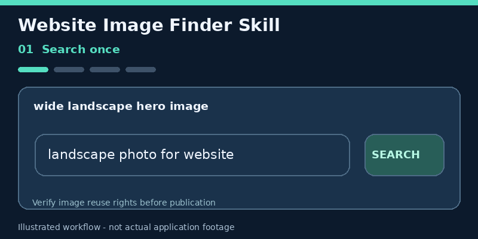

# Website Image Finder — Agent Skill

[](https://skills.sh/Bl0ck154/website-image-finder-skill)
[](https://github.com/Bl0ck154/website-image-finder-skill/actions/workflows/tests.yml)

Find real web images for websites with AI coding agents. Review candidate grids, reuse search results, export optimized assets, and keep image-source details traceable.

Works with compatible Agent Skills clients, including Claude Code, Codex and Cursor. **Free sources are the default; Google Images through SerpApi is optional and never selected automatically.**

<p align="center"></p>
<p align="center"><sub>Illustrative walkthrough with synthetic placeholders, not live search results. Verify image reuse rights before publication.</sub></p>

## Highlights

- Provider filters for layout, size, type, color, time and license; domain allow/block lists are applied locally after search
- Google Images through explicitly selected SerpApi
- Keyless DDGS, Openverse and Wikimedia Commons discovery
- Openverse for license-oriented image discovery (not automatic legal clearance)
- Local `results-cache.json` for resume and provenance; cross-run search reuse defaults to 24 hours
- Review batches via compact `candidates-XX.json` plus an explainable technical shortlist
- Dense justified `contact-sheet-XX.jpg` previews
- Next-batch downloads without another search-provider call
- Actual file validation, minimum dimensions, size limits, and duplicate filtering
- DNS-pinned downloads that reject non-public network addresses and keep HTTPS certificate checks
- WebP/PNG/JPEG finalization from original image bytes when available, with **private**, gitignored source metadata
- Explicit SerpApi request budget, bounded provider retries, and sensible exit codes
- Private run evaluation for measuring search/download reliability without sharing image URLs
- Python 3.10+; prepares isolated dependencies automatically on first use

## Install and try it

Install the Agent Skill in a supported coding agent:

```sh
npx skills add Bl0ck154/website-image-finder-skill
```

Then ask your agent:

> Use website-image-finder to find a suitable, reusable photograph for my homepage. Show candidates, optimize the best one to WebP, and add it to my project.

**Requirements:** Python 3.10+ and internet access. Node.js is needed for the optional `npx skills` installer. The skill itself is Python-based. On the first image command, its launcher checks the required libraries. If they're missing, it installs them into an **isolated local Python environment** and reuses that environment next time. No SerpApi subscription or login is required.

The launcher installs published packages listed in `requirements.txt` from PyPI. Set `WEBSITE_IMAGE_FINDER_AUTO_SETUP=0` to disable automatic package installation; alternatively run `python3 <SKILL_DIR>/scripts/skill.py setup` deliberately first. Package installation needs PyPI access and permission to write to a user cache or project directory.

Run manually, using the actual installed skill directory:

```sh
python3 <SKILL_DIR>/scripts/skill.py search "sunlit modern living room" --root . --orientation wide --batch-size 12
```

On Windows use `py -3` instead of `python3`. You can use `python3 <SKILL_DIR>/scripts/skill.py check` to inspect setup and `setup` to prepare it. On Linux and macOS, a user-wide package install is unnecessary.

**If Python is unavailable or the agent cannot install packages:** the skill instructions allow a limited fallback through the agent's own web/image search tools, if provided. That fallback cannot promise contact sheets, local optimization, or metadata files.

## Asset presets

Use `--asset-type hero|photo|logo|icon|illustration` to choose more appropriate minimum dimensions. The existing photo defaults remain 800×500; logo permits 100×60 and icon 64×64. Explicit `--min-width`, `--min-height` and `--orientation` override the preset.

When automatic free search returns image URLs but none can be downloaded, the skill tries another available free provider using its remaining download-attempt budget. License-filtered searches never silently weaken usage-rights constraints and SerpApi remains explicitly opt-in.

## How free image search works

| Provider | API key | Default selection | Trade-off |
| --- | --- | --- | --- |
| DDGS | No | First for general web images when installed | Unofficial search aggregation; sites can rate-limit or block it; usage rights are not verified |
| Openverse | No | First for license-oriented searches; otherwise free fallback | Search limited to openly licensed media; anonymous API rate limits |
| Wikimedia Commons | No | Last keyless fallback for general searches | Broad public media collection; may contain non-photo media; no provider-side safe-search |
| SerpApi Google Images | **Yes** | **Only with `--provider serpapi`** | Optional paid search credits, useful when specific Google Image results are required |

Automatic mode **never calls SerpApi**, even if `SERPAPI_API_KEY` is already set in the environment. You must explicitly request `--provider serpapi` to spend its credits. Queries with `--license creative-commons`, `commercial`, `modify`, or `commercial-modify` use Openverse in automatic mode instead of falling back to sources with uncertain license filters.

The default search-result cache duration is 24 hours, preventing identical searches from repeatedly calling providers. Use `--reuse-cache-hours 0` to force fresh results. A cache match includes the query, filters, provider policy, and selected provider. Actual candidate downloads still require network access.

External services have their own rate limits and can become unavailable. The skill does not bypass authentication, CAPTCHAs, robots policies, or access controls. Metadata must be checked against the image's original license and attribution requirements before publication. See the [Openverse API](https://api.openverse.org/v1/), [DDGS](https://pypi.org/project/ddgs/) and [Wikimedia API policy](https://www.mediawiki.org/wiki/Wikimedia_APIs/Access_policy).

## Supported skill environments

The project follows the [Agent Skills specification](https://agentskills.io/specification) and ships a root `SKILL.md` plus scripts and documentation. Claude Code, Codex, Cursor and other compatible agents can load it, provided they can execute Python and access the network. Skill recognition does not automatically give agents file-write permission.

Manual installation: copy the repository to a folder named `website-image-finder` under the skill directory supported by your agent (for example `~/.agents/skills/website-image-finder` for Codex). The folder name should match the `name` in `SKILL.md`. Use the entire repository, not just the Markdown file.

## Example

```text
Use $website-image-finder.

Find a wide hero photograph for this landing page, review the candidates,
optimize the best usable image to WebP, add it using the project's existing
conventions, preserve the source metadata, and verify the rendered page.
```

Explicit `$website-image-finder` invocation is the most reliable. Compatible agents may also invoke the skill implicitly from its description.

## Output workflow

The first successful downloaded batch creates:

```text
.image-search/<run>/
├── results-cache.json
├── candidates-01.json
├── contact-sheet-01.jpg
├── review-batch-01.json
├── originals/  # private original raster bytes for one-pass final export
└── downloaded WebP preview candidates
```

If the first batch is unsuitable:

```powershell
py -3 <SKILL_DIR>\scripts\skill.py more --root . --run .image-search\<run> --count 12
```

This uses the existing cache and creates the next batch without calling any search provider again. On newer runs, finalization prefers a private original raster to avoid recompressing a WebP review preview.

Matching results are reused for 24 hours by default (same queries, filters and provider policy). This reuses search **metadata**, not old downloaded images. Use `--reuse-cache-hours 0` for a fresh search. The default region is `auto` instead of a country-specific locale.

For explicitly selected SerpApi, at most three search requests per run are allowed by default. Multi-query or multi-page searches can raise the cap with `--max-serpapi-requests N` (up to 15). Each SerpApi page can consume a search credit.

If downloads fail, `search` reports exit code `3` rather than incorrectly claiming complete success; `--batch-size 0` still succeeds when URLs are found. `more` also returns `3` if no additional usable candidates are produced.

## Technical shortlist and run evaluation

Each successful review batch now produces a private report named review-batch-XX.json. It ranks the downloaded images using their **measured** dimensions, aspect-ratio fit, title-word overlap and available source metadata. Scores come with a breakdown and reasons. They do not evaluate artistic quality, the accuracy of depicted subjects, the site's brand identity, or whether a license is legally sufficient.

To review candidates saved across batches:

~~~sh
python3 <SKILL_DIR>/scripts/skill.py review --root . --run .image-search/<run> --top 5
~~~

The review output uses each image's original search rank (for example #7). Use that rank with the finalize command, even if the image is first in the technical shortlist.

To measure search behavior from saved caches without additional provider requests:

~~~sh
python3 <SKILL_DIR>/scripts/skill.py evaluate --root . --latest 10
~~~

It summarizes provider invocations, observed first-batch duration, successful downloads and failures. Historical runs without metrics are marked incomplete. Evaluation output omits original source URLs. This does not measure time saved by the AI agent or subjective image relevance. For practical examples and a fair comparison with normal agent search, see [Usage examples](docs/EXAMPLES.md) and [Evaluation guide](docs/EVALUATION.md).

## Checking live providers

Use a bounded, explicit diagnostic to test one or more free sources. It
runs a real search, downloads one candidate and verifies its WebP export in
a temporary project, then removes the image files.

~~~sh
python3 scripts/skill.py setup
python3 scripts/provider_smoke.py --live --provider wikimedia --query "mountain lake"
# Optional: append --provider openverse and --provider ddgs
~~~

The report includes observed downloads, attempts, timings and failure reasons,
without copying third-party image URLs into its JSON. Paid SerpApi is excluded.
This command is intentionally separate from offline CI: provider outages and
rate limits are not deterministic product failures. See
[Architecture](docs/ARCHITECTURE.md) and
[Live smoke observations](docs/LIVE_SMOKE_TEST.md).

## A real image in a working page

The [small Earth example](examples/earth/) is a complete static page with a
**real NASA Blue Marble image**, saved as a local 1280×640 WebP with the skill's
own finalizer. The page includes accessible alt text and visible image credit.


This image is identified as public domain in the United States on its
[Wikimedia Commons file page](https://commons.wikimedia.org/wiki/File:Blue_Marble_2002.jpg).
NASA's [media guidelines](https://www.nasa.gov/nasa-brand-center/images-and-media/)
still apply, including source credit and no implied endorsement. The demo
[documents the original file, SHA-256 and conversion command](examples/earth/README.md).
It illustrates a real image in an actual website, not a search-provider benchmark.

## Why use it instead of an agent's ordinary image search?

A coding agent with web search can already find image URLs. This skill provides a repeatable workflow for downloading candidates, rejecting broken or duplicate files, inspecting a contact sheet, resuming results without a new provider search, exporting optimized website assets and keeping source metadata in the project. The new shortlist helps prioritize manual review. **You still need the agent or a person to judge visual fit and verify reuse rights.**

There is no demonstrated speed advantage or adoption claim in this repository yet; the evaluation guide explains how to measure both on identical website tasks.

## Source metadata, privacy and deployment

The finalizer writes source information to `.image-search/provenance/<asset-relative-path>.source.json` inside your project (not next to `public/images/...`). When image commands run, the skill creates `.image-search/.gitignore` to exclude cached results, source URLs and optional project-local Python packages from normal `git add` operations. **Keep `.image-search/` out of web hosting and version control**: signed source URLs may contain sensitive query parameters. Do not upload search caches to public storage.

Example with a locally downloaded candidate:

```sh
python scripts/skill.py search "cozy modern workspace" --provider openverse --license commercial-modify --root . --batch-size 12
python scripts/skill.py more --root . --run .image-search/<run> --count 12
python scripts/skill.py finalize --root . --cache .image-search/<run>/results-cache.json --candidate 7 --output public/images/hero.webp
```

The agent should inspect the contact sheet, choose a relevant candidate, verify the original source's reuse conditions and integrate the resulting local image with useful alt text. It must not infer permission to publish from the search engine's metadata alone.

For a reproducible end-to-end test using live Openverse results, see [Live smoke test](docs/LIVE_SMOKE_TEST.md). It demonstrates search, download, asset finalization and private provenance without redistributing the example image.

## Compatibility and troubleshooting

| Environment | Status / notes |
| --- | --- |
| Windows + Python 3.12 | Covered by offline GitHub Actions tests; PowerShell installer available |
| macOS + Python 3.12 | Covered by offline tests; use pip or a virtual environment |
| Ubuntu + Python 3.10 / 3.13 | Covered by offline tests; use pip or a virtual environment |
| Other AI agents | Compatible with agents that recognize `SKILL.md` and can run Python/network commands |
| Live search providers | External service availability, rates, blocks, and download permissions can vary |

Quick diagnostics: `python scripts/skill.py check`, `python scripts/skill.py search --help`, and the `warnings`/candidate statuses in the run's cache. CI uses mocks and does **not** guarantee live external search.

## Copyright notice

Public availability does not grant permission to reuse an image. Search filters and provider metadata are not legal proof of licensing. Verify the original source page and applicable license before publication.

This is an independent community project and is not an official OpenAI product.

## License

MIT

## Contributing

Bug reports and improvements are welcome. See [CONTRIBUTING.md](CONTRIBUTING.md) for local checks and privacy guidelines.
